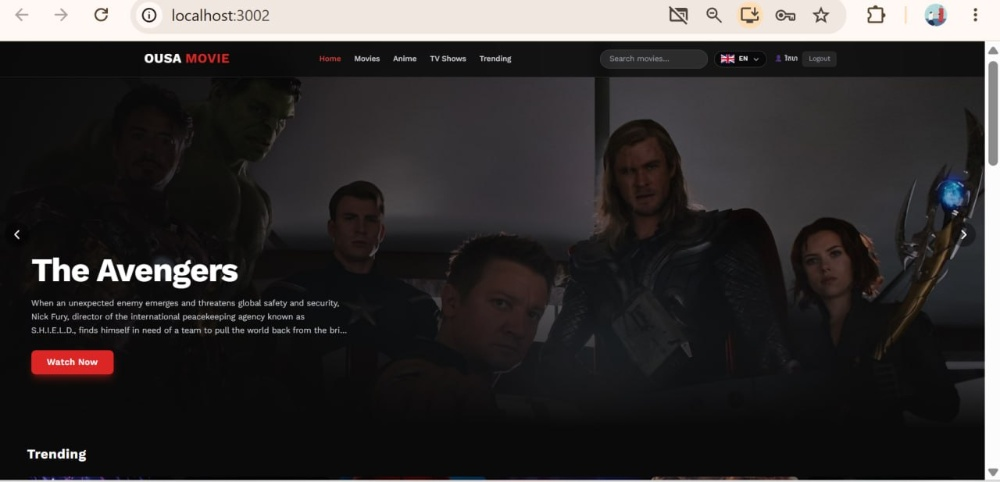
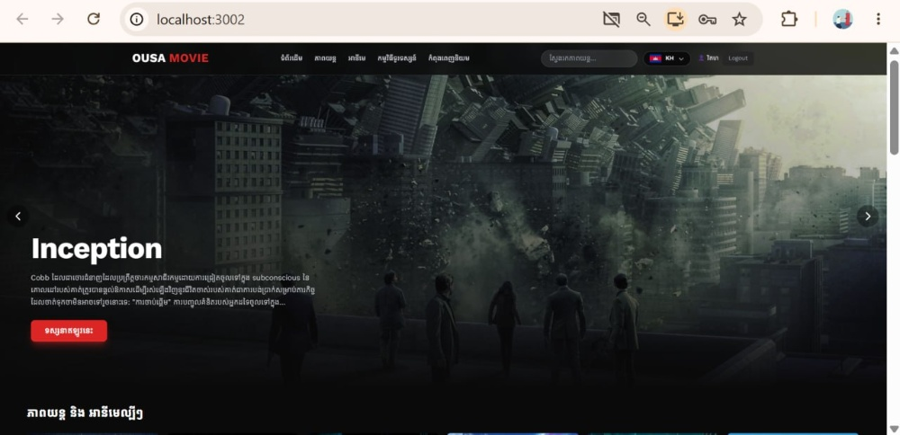
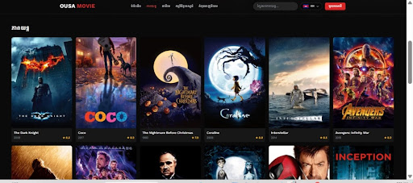
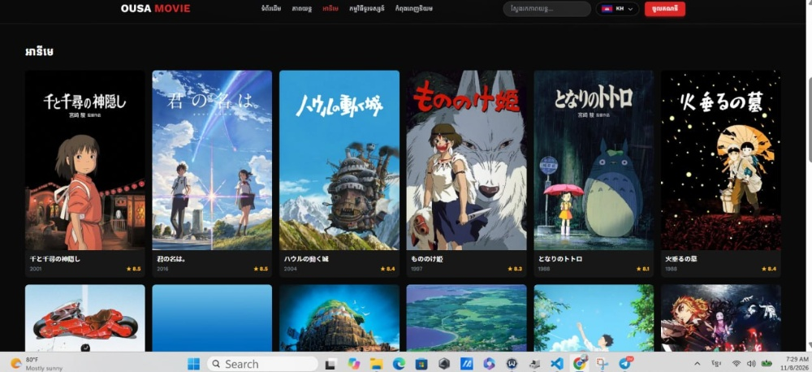
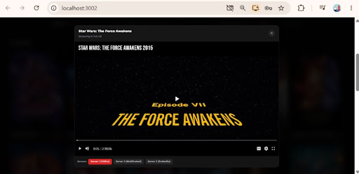
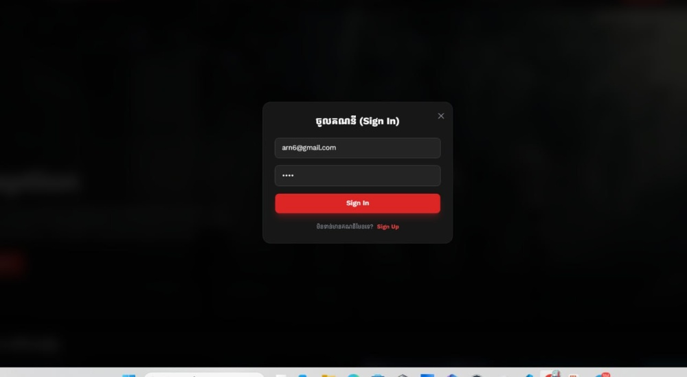

# 🎬 Ousa Movie

A movie and TV streaming website built with **React** (frontend) and **FastAPI** (backend). It supports **Khmer** and **English**, user login, an admin dashboard, and movie data from the **TMDB API**.



## ✨ Features

- 🎞️ Hero slideshow with autoplay and a **Watch Now** button
- 📂 Categories: **Home, Movies, Anime, TV Shows, Trending**
- 🔍 Search movies and TV shows
- 🌐 Khmer (KH) and English (EN) language switcher with flag icons
- ▶️ Watch modal with multiple streaming servers (VidSrc, MultiEmbed, EmbedSu)
- ⭐ Rating and release year on every movie card
- 🔐 Login and register modal, with username and logout in the header
- 🛠️ Admin dashboard to manage movies
- 📱 Responsive design for desktop and mobile
- 🔤 Khmer font support (Kantumruy Pro) together with Inter

## 🛠️ Tech Stack

| Part | Technology |
| --- | --- |
| Frontend | React (Create React App), Tailwind CSS v3 |
| Backend | Python, FastAPI, Uvicorn |
| Movie data | [TMDB API](https://www.themoviedb.org/documentation/api) |
| Fonts | Inter, Kantumruy Pro (Google Fonts) |

## 📸 Screenshots

### Home


### Khmer language



### Movies



### Anime



### Watch movie



### Login / Register



## 📁 Project Structure

```
Movie Frontend and backend/
├── README.md
├── .gitignore
├── docs/
│   └── screenshots/          # README images
├── frontend-user/            # React app
│   ├── public/
│   └── src/
│       ├── components/       # Header, Slideshow, Footer, WatchModal,
│       │                     # AuthModal, AdminDashboard, translations
│       ├── App.js
│       └── index.js
└── backend/                  # FastAPI app
    ├── database.py           # Database connection
    ├── models/               # Database models (movie.py, ...)
    ├── schemas/              # Pydantic schemas (movie.py, ...)
    ├── crud/                 # Database operations (movie.py, ...)
    └── ...                   # Routes (movies.py, auth, ...)
```

## 🚀 Getting Started

### Requirements

- [Node.js](https://nodejs.org/) 18 or newer
- [Python](https://www.python.org/) 3.10 or newer
- A free [TMDB API key](https://www.themoviedb.org/settings/api)

### 1. Clone the repository

```bash
git clone https://github.com/virakbothchharn6-tech/Movie-webiste.git
cd Movie-webiste
```

### 2. Run the backend (FastAPI)

```bash
cd backend
python -m venv venv

# Windows
venv\Scripts\activate
# macOS / Linux
source venv/bin/activate

pip install -r requirements.txt
uvicorn main:app --reload
```

- API: `http://localhost:8000`
- Swagger docs: `http://localhost:8000/docs`

> If your entry file has a different name, change `main:app` to match it.

### 3. Run the frontend (React)

Open a second terminal:

```bash
cd frontend-user
npm install
npm start
```

The website runs at `http://localhost:3000`.

## 🔑 Environment Variables

Never commit real keys. `.env` files are listed in `.gitignore`.

**frontend-user/.env**

```env
REACT_APP_TMDB_KEY=your_tmdb_api_key
REACT_APP_API_URL=http://localhost:8000
```

**backend/.env**

```env
SECRET_KEY=your_secret_key
# Add your database settings here
```

Restart `npm start` or `uvicorn` after changing a `.env` file.

## 🔌 API Endpoints

The full list with request examples is in the Swagger docs at `/docs`.

| Method | Endpoint | Description |
| --- | --- | --- |
| POST | `/register` | Create a new account |
| POST | `/login` | Log in and get a token |
| GET | `/movies` | Get all movies |
| POST | `/movies` | Add a movie (admin) |
| PUT | `/movies/{id}` | Update a movie (admin) |
| DELETE | `/movies/{id}` | Delete a movie (admin) |

> Change this table to match your real routes.

## 🗺️ Roadmap

- [ ] My List (save favorite movies)
- [ ] Movie detail page
- [ ] Watch history
- [ ] Deploy frontend and backend

## ⚠️ Disclaimer

This project is for **learning purposes only**. Movie information and images come from TMDB. This product uses the TMDB API but is not endorsed or certified by TMDB. The player uses third-party embed servers, and this project does not host any video files.

## 👤 Author

**Virakboth Chharn**
GitHub: [@virakbothchharn6-tech](https://github.com/virakbothchharn6-tech)